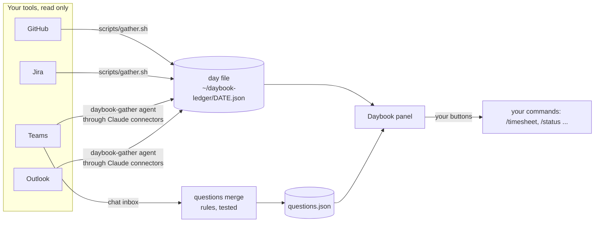

# Daybook

**Your working day, beside Claude Code.** One panel that shows what needs you right now: review
comments on your PRs, questions still waiting for an answer, your tickets, and how much time you've
logged against the day. It's gathered from the tools you already use, and it only reads.

[](LICENSE)


> **See it in ten seconds:** install it, then type `/daybook demo`. You get a full week of made-up
> data, and nothing of yours is read.

---

## Why

| Without it | With Daybook |
|---|---|
| Six tabs every morning: GitHub, Jira, Teams, Outlook, the timesheet, your notes | One panel, refreshed with one button |
| "Did they answer my question?" means scrolling chat | Each question is tracked, and closes itself when the reply arrives |
| A new review comment sits unseen for hours | **Needs you** lists it, with a link |
| Friday's timesheet is guesswork | Each day's time is already shown against your target range |
| Standup notes, status update and timesheet tell three different stories | They're all built from the same day file, so they agree |

## What you see

| Card | What it shows |
|---|---|
| **Needs you** | New review comments, requested changes, asks aimed at you, and a short day |
| **Time** | Today against your range, the week as bars, and any weekday picked to see its tickets |
| **Questions** | What you've asked and who it waits on, with **Open in Teams**. **Mark answered** and **Not a question** can both be undone |
| **Answered** | Recent answers, with the reply and a link back to it |
| **Pull requests** | Your open and merged PRs, review state, and their tickets |
| **Tickets** | Your tickets in development or review, with time logged today |
| **Board** | Your project's whole board: area, status, search, "mine only", ten rows a page |
| **Settings** | Which tool fills each part, and **Check connections** with the exact fix for anything off |

Every card folds. The panel remembers which cards you folded, and its tables drop columns on a narrow pane.

## Install (two minutes)

In Claude Code:

```
/plugin marketplace add Zeeshan138063/daybook
/plugin install daybook@daybook
```

Then:

```
/daybook-setup     # finds your connected tools, asks a few questions, writes your config
/daybook           # opens the panel; press Refresh
/daybook doctor    # anything not connected, with the exact fix
```

Needs: Claude Code, Python 3.11+, and the tools you use (see below). Optional: `uv`.

## Connect your tools

| Part | Supported today | How it's reached | You need |
|---|---|---|---|
| Code | **GitHub**, plus local git | the `gh` CLI's own sign-in | `gh auth login` |
| Tickets and time | **Jira** (worklogs) | the jira-agent plugin's sign-in, or an API token kept in an environment variable or the Keychain | your site, e.g. `you.atlassian.net` |
| Chat | **Microsoft Teams** | the Microsoft 365 connector in Claude | the connector turned on and signed in |
| Calendar | **Outlook** | the Microsoft 365 connector in Claude | the same connector |
| Coming | GitLab, Linear, Slack, Gmail and Google Calendar, Toggl | | contributions welcome |

Every tool gets the same three steps: **connect** it (sign in, or turn the connector on), **run
`/daybook-setup`**, then **check** with `/daybook doctor` until every line has a ✔.

## How it works



- **The day file** is one JSON file per day: the single source the panel and your commands read.
- **The collectors** are small read-only adapters behind one contract (ports and adapters), so adding a
  provider means adding one adapter.
- **Questions** are captured once, by chat message id. A reply that quotes the question closes it,
  as does one that names its ticket, or a dated "Decided" note on the ticket. The rules are code
  with tests, not a model's guess.

## Configure it

Your config is one JSON file (`~/.claude/daybook/config.json`); `schema/config.schema.json`
documents every key, and `/daybook-setup` writes it for you. The action bar is yours to define:

```json
"actions": {
  "primary": { "label": "Propose timesheet", "command": "/timesheet" },
  "buttons": [
    { "label": "Draft status", "command": "/status", "hint": "for {reviewer}" },
    { "label": "Start ticket", "command": "/start", "hint": "next {next_ticket}" }
  ],
  "time_short": "/timesheet"
},
"schedule": [{ "at": "17:30", "commands": ["/timesheet"] }]
```

## Privacy

- **Only reads.** It never posts, comments, moves a ticket or sends a message.
- **Stays on your machine.** The config, day files and questions are local files, and there's no server.
- **No secrets in config.** A token is referenced by where it lives, never written down.
- **Safe screenshots.** `/daybook demo` uses invented names (Alex Example, PROJ-123, example.com)
  so you can share images freely.

## Contributing

See [CONTRIBUTING.md](CONTRIBUTING.md). New providers are the most wanted.
[SECURITY.md](SECURITY.md) says how to report a problem privately.

## License

[MIT](LICENSE) © 2026 Muhammad Zeeshan
