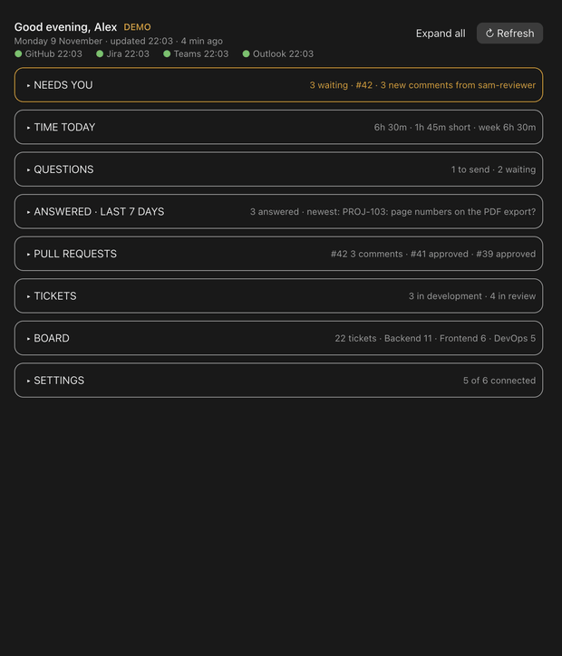
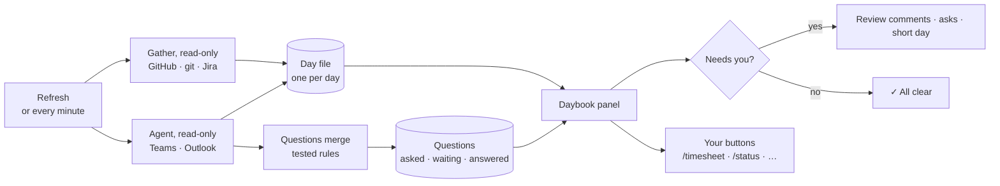
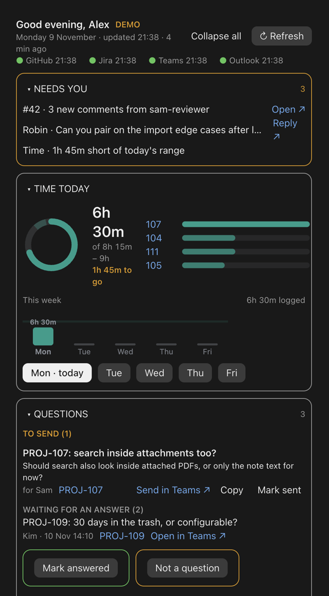
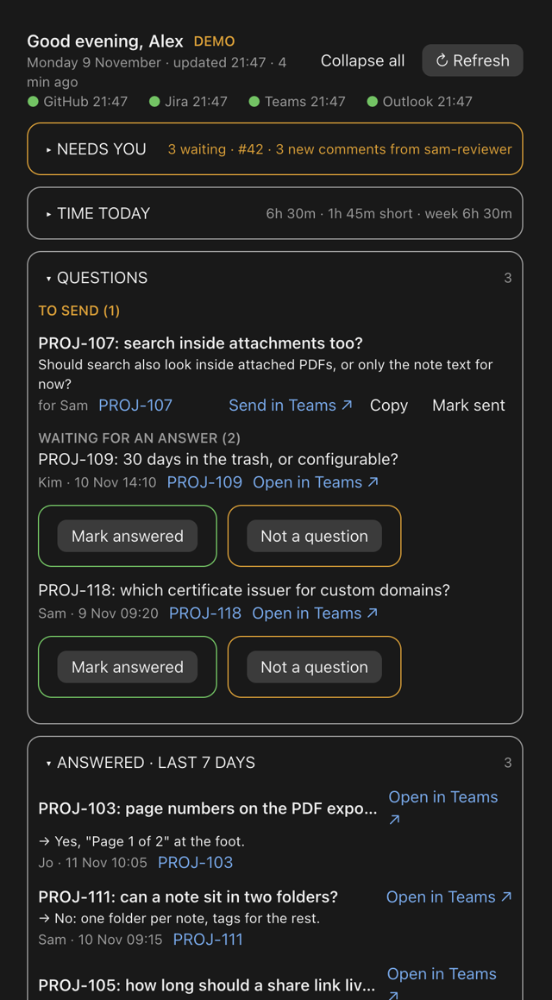
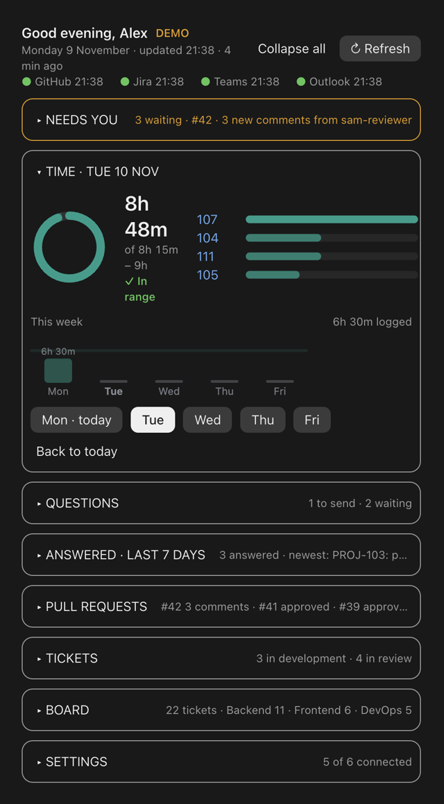
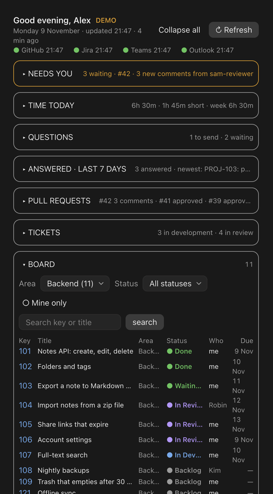
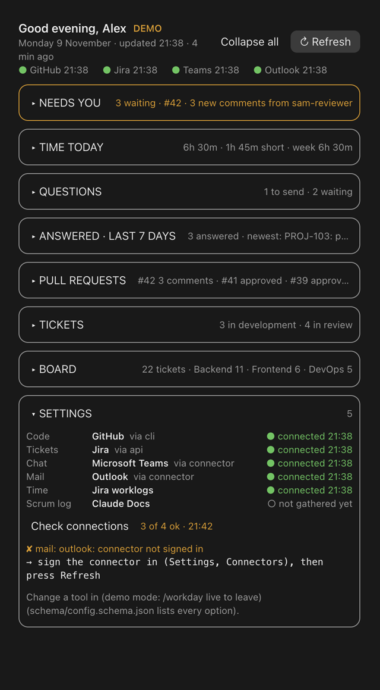

# Daybook

[](https://github.com/Zeeshan138063/daybook/actions/workflows/ci.yml)   

**Your working day, beside Claude Code.**

<p align="center">
  
  <br><sub>Sample data. Names and messages are made up.</sub>
</p>

Daybook is a panel that sits next to your Claude Code chat and shows what needs you right now:
- new review comments on your pull requests;
- questions you asked that are still waiting for an answer;
- your tickets;
- how much time you've logged against the day.

It gathers all of this from the tools you already use (GitHub, Jira, Microsoft Teams, Outlook), and it only reads from them.

> *daybook* (noun): a book in which the day's business is recorded as it happens.

If you write code for a living, your day is split across six tabs: the code host, the tracker, chat,
the calendar, the timesheet and your notes. Review comments sit unseen, questions get lost in chat,
and on Friday the timesheet is guesswork. Daybook puts the day in one place and keeps it current.



**Try it in ten seconds:** install it, then type `/daybook demo`. You get a full week of made-up
data, and none of yours is read.

## See it

| Your day at a glance | Questions that close themselves |
| --- | --- |
|  |  |
| **Any weekday's time** | **The whole board** |
|  |  |
| **Check connections** | |
|  | |

<sub>Sample data from `/daybook demo`. Names and messages are made up.</sub>

## When it runs

| What | When | What you get |
| --- | --- | --- |
| **Refresh** | When you press it | Code, git and tickets straight away, then chat and calendar about a minute later |
| **Panel reload** | Every minute | The cards follow the day file; a new review comment shows without another click |
| **Your timed runs** (optional) | The times in your config, once a working day, never at weekends | Your own commands, e.g. `/standup` at 09:00 and `/timesheet` at 17:30 |
| **Question closing** | Every Refresh | Questions whose answer arrived move to Answered, with the reply and a link |
| **On demand** | Any time | `/daybook doctor` to check connections, `/daybook demo` to show it to someone |

## What it does

### Your day

| Feature | What you get |
| --- | --- |
| **Needs you** | New comments and requested changes on your PRs, asks aimed at you, and a short day. Each has a link or a button |
| **Time** | Today against your target range as a ring, the week as bars, and any weekday picked to see its tickets |
| **Greeting and freshness** | When each source was last read; a source more than 2 hours old turns amber |
| **Your buttons** | An action bar of commands you already have (`/timesheet`, `/status`, …), plus timed runs; you configure both |

### Questions

| Feature | What you get |
| --- | --- |
| **Captured once** | Every question you ask in chat, by message id; numbered questions are split into one entry each |
| **Closes itself** | When a reply quotes it, names its ticket, or a dated "Decided" note lands on the ticket |
| **Open / Send in Teams** | Jump to the exact message, or open a chat with a drafted question typed in. You press send |
| **Answered card** | The last 7 days of answers: the reply, who gave it, when, and a link to it |
| **You stay in charge** | **Mark answered** and **Not a question**, both with **Undo** and **Restore** |

### Code and tickets

| Feature | What you get |
| --- | --- |
| **Pull requests** | Your open and recently merged PRs, review state, new comments, and the tickets each covers (one link opens them all) |
| **Tickets** | Your tickets in development or review, start and due dates, and time logged today |
| **Board** | The whole project: area, status, search, "mine only", ten rows a page, and narrow-pane friendly |

### Setup and health

| Feature | What you get |
| --- | --- |
| **`/daybook-setup`** | Finds the connectors you already have, asks a few questions, writes a schema-valid config, installs the gather agent |
| **`/daybook doctor`** | One line per tool: a ✔, or the exact command to fix it. It's also in Settings as **Check connections** |
| **`/daybook demo`** | A week of made-up data that changes nothing, for trying it out and for screenshots |

## Requirements

- **Claude Code**, with plugins.
- **Python 3.11+**. `uv` is optional (it's used with the jira-agent plugin).
- **Your tools:**
  - the GitHub CLI (`gh`);
  - Jira, through the jira-agent plugin or an API token;
  - the Microsoft 365 connector in Claude, for Teams and Outlook.

  Every tool is optional except a code host. See [Connect your tools](docs/connect/README.md).

## Install

```
/plugin marketplace add Zeeshan138063/daybook
/plugin install daybook@daybook
```

## Set up (about 2 minutes)

```
/daybook-setup
```

It will:

1. See which connectors you already have (Teams, Outlook, …) and suggest them.
2. Ask up to six things: your name, your reviewer, your repo folders, your tracker, chat and mail,
   and your day's range.
3. Work out each repo from its git remote, and write `~/.claude/daybook/config.json`. It keeps any
   old config as a backup, and never asks for a token.
4. Install the gather agent with exactly the connector tools you use.
5. Run the doctor and show what's connected, with the fix for anything that isn't.

Then `/daybook` opens the panel; press **Refresh**.

## Commands

| Command | Use it for |
| --- | --- |
| `/daybook` | Open the panel |
| `/daybook demo` · `/daybook live` | Show made-up data, then go back to yours |
| `/daybook doctor` | Check every connection |
| `/daybook-setup` | First-time setup, or changing tools |
| `/daybook-refresh` | Read chat and calendar now (Refresh runs it for you) |

## The panel

| Card | What's there |
| --- | --- |
| **Header** | The greeting, the date, when each source was read, **Refresh**, and **Collapse all** |
| **Needs you** | What's waiting on you, each with a link or a button |
| **Time** | The day's ring, the week, any weekday's tickets |
| **Questions** | To send, waiting, and the hidden ones |
| **Answered** | The last 7 days of answers (folded at first) |
| **Pull requests** · **Tickets** · **Board** | Your code and tracker, linked |
| **Settings** | Which tool fills each part, and **Check connections** |

## Configure

Everything lives in one file, `~/.claude/daybook/config.json`; [Configuration](docs/configuration.md)
lists every key. Your buttons, for example:

```json
"actions": {
  "primary": { "label": "Propose timesheet", "command": "/timesheet" },
  "buttons": [{ "label": "Draft status", "command": "/status", "hint": "for {reviewer}" }]
},
"schedule": [{ "at": "17:30", "commands": ["/timesheet"] }]
```

## Privacy and safety

- **Reads only.** It never posts, comments, moves a ticket, logs time or sends a message. Your
  buttons run commands you chose, and those ask before they write.
- **Stays on your machine.** The config, day files and questions are local files, and there's no server.
- **No secrets in config.** A token is named by where it lives (`{"env": …}` or `{"keychain": …}`).
- **Safe to show.** Demo mode uses invented names only.

## Limits

- **Tools supported today:** GitHub, Jira, Teams and Outlook.
- **Chat and calendar lag a little:** they go through Claude connectors, which only an agent can
  use, so they fill in about a minute after Refresh.
- **Unquoted answers:** a question closes when its answer quotes it or names its ticket. Others need **Mark answered**.
- **Panel tests run locally:** they need the Claude Code engine, so CI runs only the Python checks.

## Roadmap

- **More tools:** GitLab, Linear, Slack, Gmail and Google Calendar, Toggl.
- **For PRs:** a review checklist that ticks itself off as commits land, CI status per PR, and a stale-branch warning.
- **For the day:** a resume card ("where you left off"), a day replay with evidence for each worklog, and a handoff pack.
- **For questions:** a decision register built from answered questions, and "ask once", which checks past answers before you ask again.

## Learn more

- [How it works](docs/how-it-works.md): the architecture, the data flow and the data model.
- [How questions are tracked](docs/questions.md).
- [Connect your tools](docs/connect/README.md): one card per tool.
- [Configuration](docs/configuration.md).
- [Troubleshooting](docs/troubleshooting.md): every doctor message and its fix.

## Repository layout

```
hooks/            the panel (register.tsx), demo data, panel tests
collectors/       read-only adapters behind one contract, plus questions, doctor, tests
agent-templates/  the gather agent's template and per-tool sections
skills/           /daybook-setup and /daybook-refresh
schema/           config, day file and questions, as JSON Schema
scripts/          setup, doctor, gather, privacy check
docs/             these guides
```

## Contributing

See [CONTRIBUTING.md](CONTRIBUTING.md). New tools are the most wanted contributions.
[SECURITY.md](SECURITY.md) says how to report a problem privately.

## License

[MIT](LICENSE) © 2026 Muhammad Zeeshan
