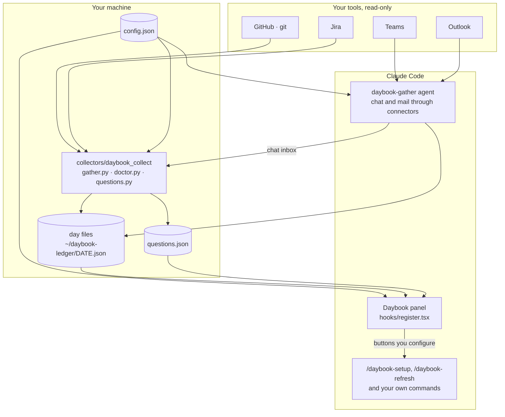
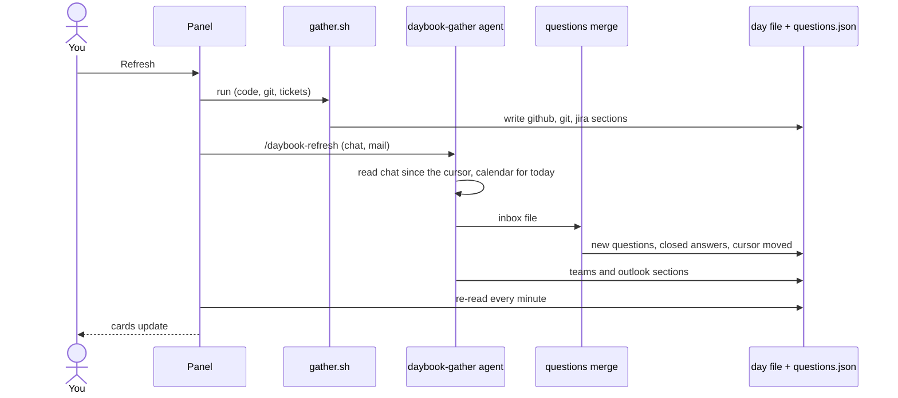
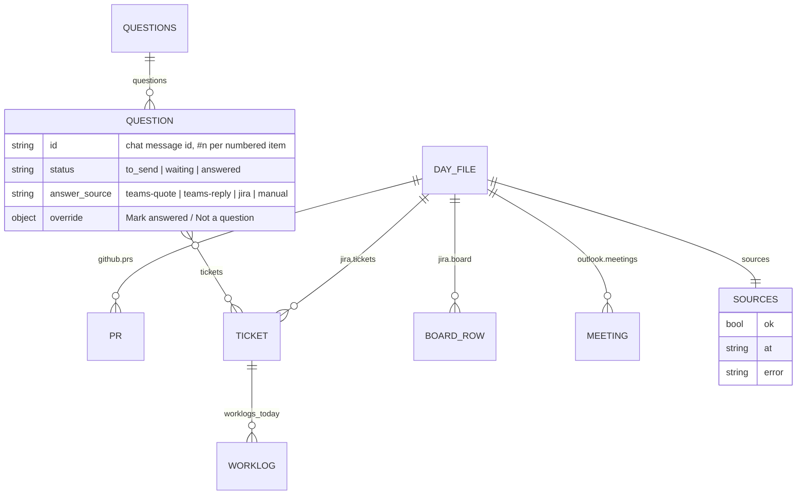

# How Daybook works

Daybook has three parts:
- a **panel** that draws your day;
- **collectors** that gather it, read-only;
- a few **local files** that hold it.

Nothing runs on a server, and nothing writes to your tools.

## Architecture

| Part | Where | What it does | Why it's built this way |
|---|---|---|---|
| Panel | `hooks/register.tsx` | Reads the day file and questions, and draws the cards. It re-reads every minute | A Claude Code mod sits beside the chat, so there's no browser tab to keep open |
| Collectors | `collectors/daybook_collect/` | One adapter per tool behind one contract (`contract.py`), chosen in `registry.py` | Ports and adapters: adding a tool means adding one file, and the panel never changes |
| Gather agent | `agents/daybook-gather.template.md` | Reads chat and calendar through Claude connectors, which only an agent can reach | Its tool list is exactly the connectors your config names, and nothing else |
| Questions merge | `collectors/daybook_collect/questions.py` | Decides what counts as a question and what answers it | These are tested rules in code, so the result never depends on a model's mood |
| Doctor | `collectors/daybook_collect/doctor.py` | Shows one line per tool: a ✔, or the exact fix | Turns "it doesn't work" into a command you can run |

## Data flow: one Refresh

## Data model

The full shapes are in `schema/day.schema.json`, `schema/questions.schema.json` and
`schema/config.schema.json`.
